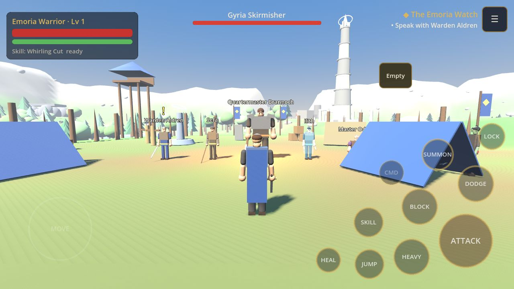
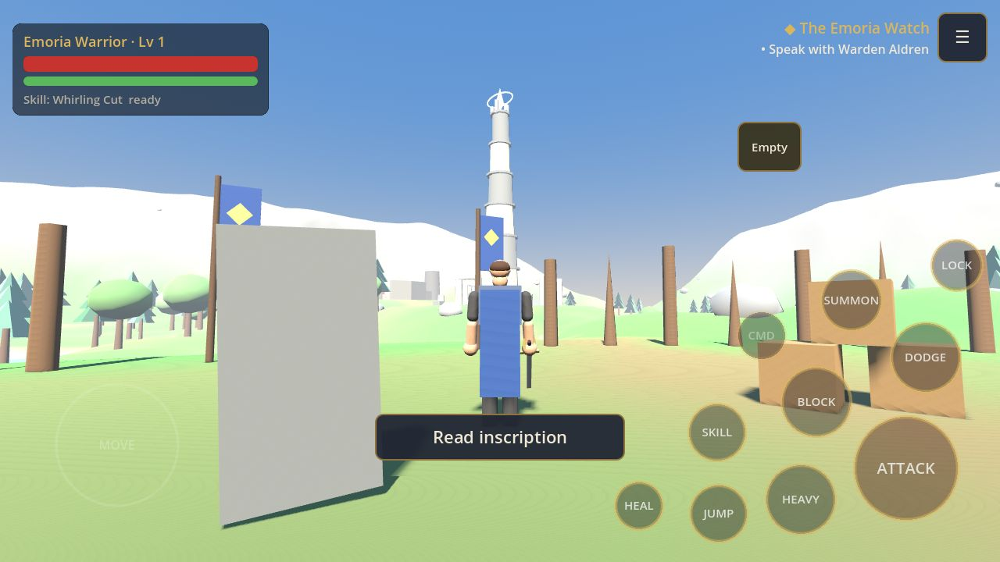
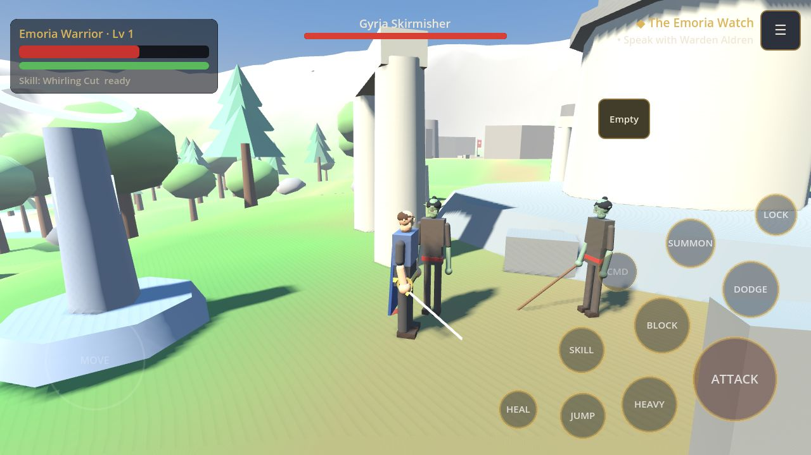
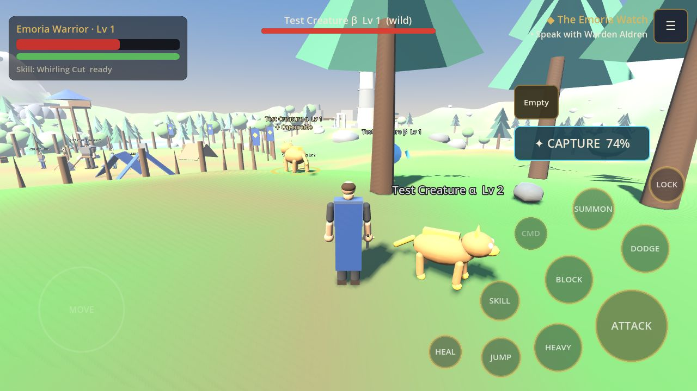
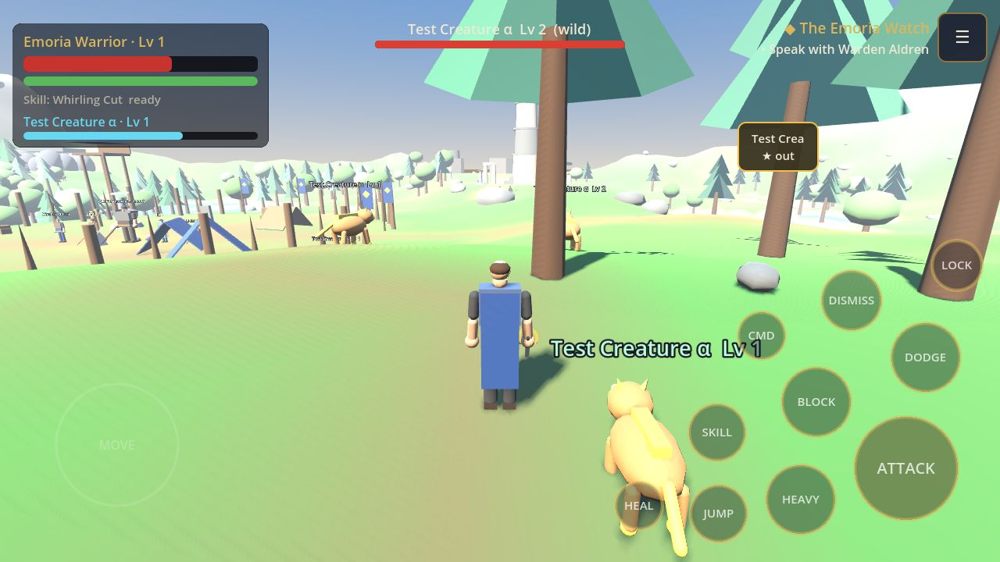
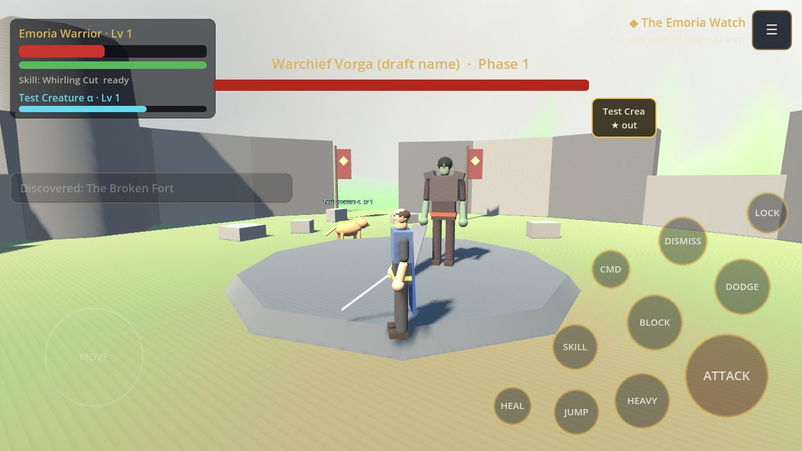
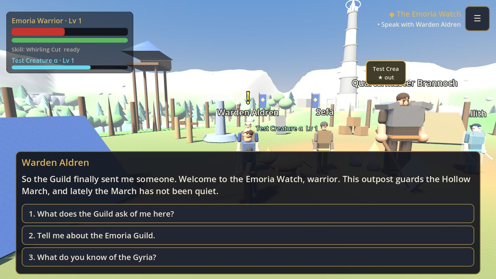
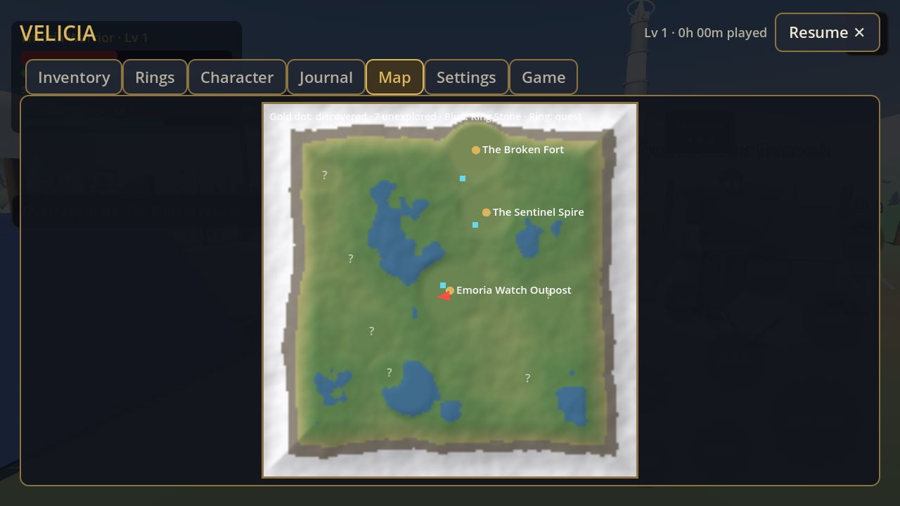

# Velicia

An original stylised 3D fantasy action RPG for Android, built with **Godot 4**
and **GDScript**. You are a warrior of the ancient **Emoria Guild**, sworn to
protect Velicia — a land of humans, Amir, Burrok, Vapouriun, Gouran and Gyria —
armed with steel and magical rings that bind creatures to fight at your side.

> **Status: playable prototype (vertical slice of the first region).**
> Systems are real and tested; **all art and audio are placeholders**, and
> story content beyond the established canon is **draft**. See
> [ROADMAP.md](ROADMAP.md) for everything still to do. This is not the finished game.

## What you can do in this build
- Create your Emoria warrior (skin, hair, cloak, build) and start a new game.
- Explore **the Hollow March** (≈360 × 360 m): the Emoria Watch Outpost, the
  Sentinel Spire landmark, a Gyria war-camp, a boss fort, a lake shore ruin,
  a hidden hollow, an old battlefield, forests and meadows.
- Third-person movement: walk/run (analogue), sprint, jump, follow camera
  with collision, soft-targeting and lock-on.
- Melee combat with weight and timing: 3-hit light combo, guard-breaking heavy
  attack, block, **timed parry** (critical riposte), **dodge with i-frames**,
  stamina, poise/stagger, knockback, hitstop and screen shake.
- Gyria enemies with telegraphed attacks, guarding, group coordination
  (attack tokens), patrols and leashing — and **Warchief Vorga**, a two-phase
  boss with a ground-slam, charge and frenzy.
- **Magical creature rings**: weaken, daze and capture creatures, summon and
  dismiss them, command your companion, level them up, deepen your bond to
  unlock abilities, train them with the ring-sage, and manage rings and the
  vault at Ring Stone shrines. *(Three clearly-labelled temporary test
  creatures are included until the official roster is designed.)*
- Five quests (a three-part main story with a moral choice, plus two side quests),
  branching dialogue, NPC routines, lore entries, faction reputation,
  discoverable locations, chests and collectibles.
- Inventory and equipment (weapons change your attacks' damage, speed and
  reach; armour changes your look), consumables, character levels, attribute
  points and unlockable Guild abilities.
- Map, quest journal, character and creature screens, settings (audio,
  graphics, controls, accessibility).
- Saving: rest at a Ring Stone or save from the menu; versioned saves with
  automatic backup recovery.
- Touch controls for two thumbs, plus keyboard/mouse and gamepad.

## Screens (rendered from this build — placeholder art)
| | |
|---|---|
|  |  |
|  |  |
|  |  |
|  |  |

Regenerate with `tools/screenshots.tscn` (see below).

## Project structure
```
scenes/        main menu, game root, player, region
scripts/       autoload singletons, data classes, player, enemies, creatures,
               world, dialogue, UI (see docs/TECH_PLAN.md)
data/          all content: items, attacks, enemies, creatures, abilities,
               quests (.tres) and dialogue/lore (.json)
audio/         original procedurally generated placeholder sounds and music
tests/         automated headless test suite
tools/         generators (input map, data, audio, region layout), checkers
docs/          design, technical and build documentation
```

Key documents:
- [docs/CHARACTER_DESIGN.md](docs/CHARACTER_DESIGN.md) — authoritative rules for the six peoples
- [docs/TECH_PLAN.md](docs/TECH_PLAN.md) — architecture and decisions
- [docs/CREATURE_SYSTEM.md](docs/CREATURE_SYSTEM.md) — how rings work and how to add creatures
- [docs/STORY_DRAFT.md](docs/STORY_DRAFT.md) — draft names and story awaiting approval
- [docs/ASSET_REQUIREMENTS.md](docs/ASSET_REQUIREMENTS.md) — what final art is needed and how to swap it in
- [docs/ASSET_LICENSES.md](docs/ASSET_LICENSES.md) — sources and licences
- [docs/ANDROID_BUILD.md](docs/ANDROID_BUILD.md) — phone setup, APK builds and controls

## Open and run in Godot
**On a phone:** follow [docs/ANDROID_BUILD.md](docs/ANDROID_BUILD.md)
(import the folder in the Godot Android editor and press ▶ Run Project, or
install the APK built by GitHub Actions).

**On a computer:** install Godot 4.3 or newer, choose *Import*, select
`project.godot`, then press **F5**. Click the game view to capture the mouse
(F1 releases it). To try the touch layout on desktop, set
*Settings → Controls → Touch controls* to **On** (mouse clicks act as touches).

## Tests and checks
Run from the project folder (any OS with Godot on the PATH as `godot`):
```
godot --headless --editor --quit            # first-time import
godot --headless res://tools/check_scripts.tscn   # compile all scripts, load all resources
godot --headless res://tests/test_runner.tscn     # gameplay test suite (exit code = failures)
```
GitHub Actions runs both on every push (`.github/workflows/tests.yml`) and
builds a debug APK on `main` or on demand (`.github/workflows/android.yml`).

Screenshots (needs a display or Xvfb):
```
godot --rendering-driver opengl3 res://tools/screenshots.tscn -- /path/to/output
```

## Implementation status
| Area | Status |
|---|---|
| Project, Android export preset, input map | Done |
| Player movement, camera, collision | Done (procedural animation) |
| Combat (light/heavy/block/parry/dodge/stamina/poise) | Done, tuning ongoing |
| Gyria soldiers (2 types) + Warchief boss (2 phases) | Done |
| Creature rings: capture, summon, companion AI, XP, bond, training, vault | Done (test creatures only) |
| Region 1 (Hollow March) with locations, NPCs, quests | Playable draft |
| Dialogue, quests, reputation, lore, map, journal | Done |
| Inventory, equipment, consumables, levels, abilities | Done |
| Save/load (versioned, backup) | Done and tested |
| Menus, HUD, settings, accessibility options | Done |
| Audio system + placeholder SFX/music | Done |
| Final 3D models, animations, VFX, UI art, music | **Not started** — see ASSET_REQUIREMENTS.md |
| Official creature roster | **Awaiting designs from the author** |
| Further regions, full story | See ROADMAP.md |

## Next milestones
1. Feel and balance pass from phone play-testing (camera, parry window, enemy timing).
2. Animation pipeline: AnimationTree adapter so rigged glTF models can replace placeholders.
3. Official creatures (from the author) + more creature behaviours.
4. More enemy archetypes (Gyria archers, shield-bearers), ambushes and night/weather.
5. Second region and travel; expanded main story after approval.
