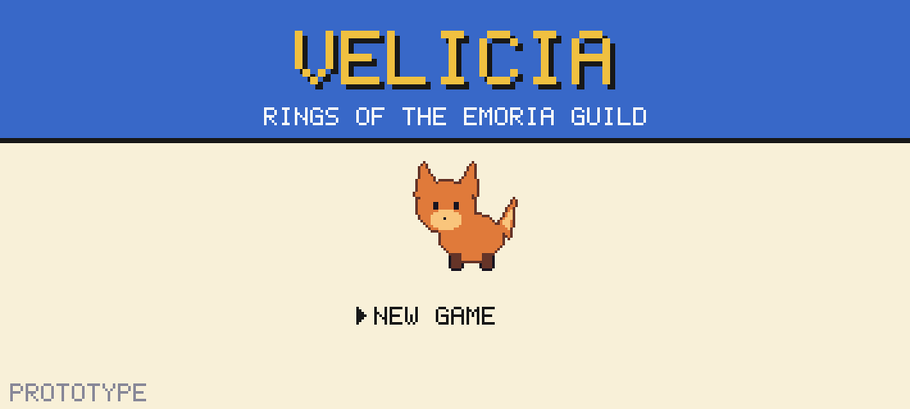
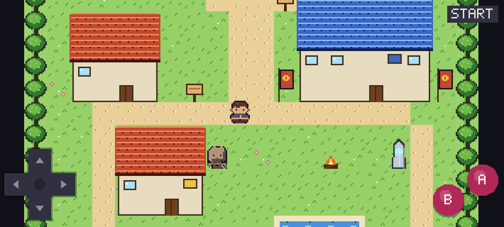
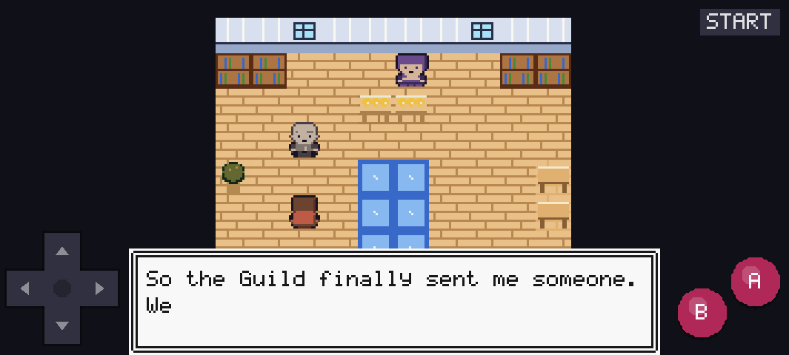
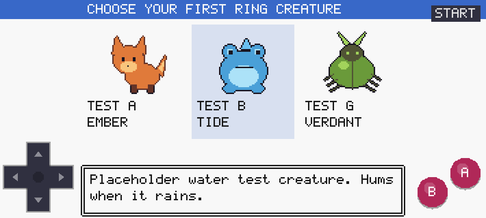
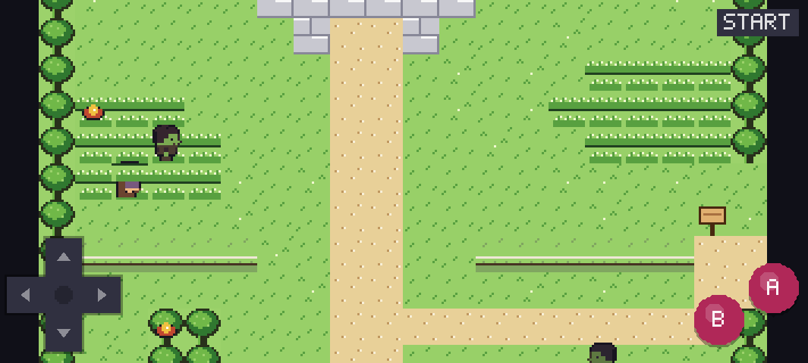
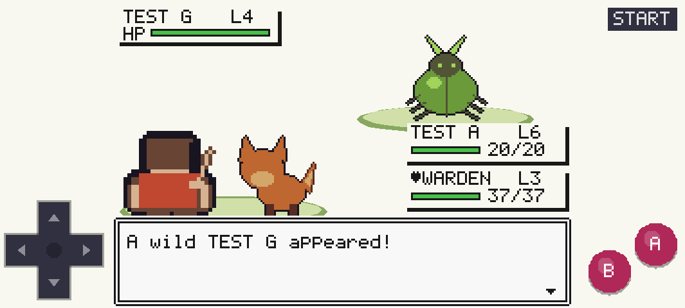
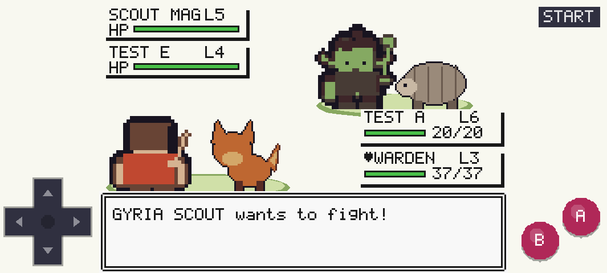
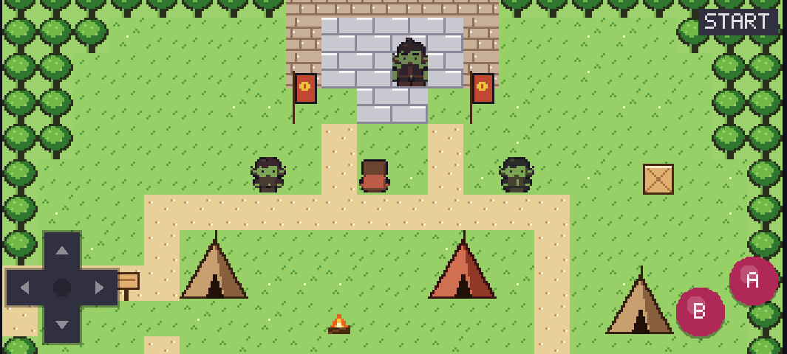
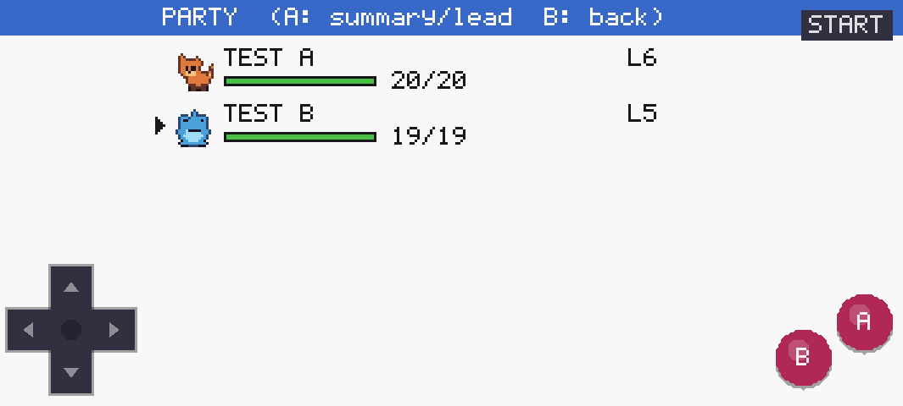

# Velicia

A **Game Boy Color-style creature RPG** for Android, built with **Godot 4**
and **GDScript**. You are a warrior of the ancient **Emoria Guild** in a land
of six peoples: humans, Amir, Burrok, Vapouriun, Gouran and Gyria. Bind wild
creatures to magical rings, and fight *beside* them: in Velicia the warrior
battles too.

> **Status: playable prototype.** All art and music are original and drawn or
> composed from code. The creature roster is **labelled test creatures**
> (Test A–E) until the official roster exists, and story text beyond the
> canon is **draft**. See [ROADMAP.md](ROADMAP.md).

| | | |
|---|---|---|
|  |  |  |
|  |  |  |
|  |  |  |

## How it plays
- **Overworld:** tile-by-tile movement with a 3-frame walk cycle. Houses you
  can enter, signs, Ring Stones that heal you and become your respawn point,
  hidden items, one-way ledges, and tall grass full of wild creatures.
- **Battles (the twist):** each turn you command **two** fighters:
  - your **ring creature**: one of its moves, or SWAP;
  - **your warrior**: STRIKE with the sword, GUARD (shield your creature by
    taking every hit at half damage), RING (bind a weakened wild creature),
    BAG (tonics and elixirs) or RUN.

  Enemies attack either of you. Gyria warbands field a **fighter and a
  creature at once**. If your creature faints you can fight on alone, but if
  **your warrior** falls you black out at the last Ring Stone.
- **Creatures:** levels, XP, moves learned by level, a draft element chart
  (Ember, Tide, Verdant, Gale, Stone), bond, a 3-ring party plus the Guild
  vault.
- **Story slice:** report to the Warden and choose a starter from Master
  Oddrin, the Gouran ring-sage. Then meet the scout on the Hollow Road, fight
  Gyria scouts, and decide Kesh's fate at Ashfen Camp. Finally, defeat
  Warchief Vorga. Side quests come from Ilith (Vapouriun) and Oddrin, and
  Brannoch (Burrok) runs the shop.
- **Controls:** on-screen D-pad, A, B and START (multi-touch); keyboard
  (arrows/WASD, Z/J = A, X/K = B, Esc/Tab = START); gamepad.

## Project layout
```
scenes/main.tscn          the game (scripts/game_root.gd)
scripts/autoload/         Events, Data, Controls, Game (state + saves), Audio
scripts/world/            Overworld (maps, warps, trainers, grass), Walker (grid movement)
scripts/battle/           Battle (screen + turn flow), BattleLogic (pure maths)
scripts/core/             Creatures (stats, XP, moves), DialogueRunner, PixelFont
scripts/ui/               TextBox, MenuBox, PanelScreen (party/bag/shop/starter), TitleScreen, TouchPad
data/                     creatures, moves, elements, items, quests (JSON); dialogue/*.json; maps/*.json
art/                      generated GBC-style tiles, sprites, battle sprites, font
audio/                    music (generated chiptune) and sound effects
tools/                    gbc_art.py, make_maps.py, make_music.py, shots.tscn, check_scripts.tscn
tests/                    headless test suite
```
Content is data: edit `tools/make_maps.py` (then run it) for maps, and
`data/*.json` for creatures, moves, items, quests and dialogue.

## Run, test, build
- Open the folder in Godot 4.3+ and press Play.
- Checks: `godot --headless res://tools/check_scripts.tscn` and
  `godot --headless res://tests/test_runner.tscn`. CI runs both on every push.
- Screenshots: `godot --rendering-driver opengl3 res://tools/shots.tscn -- out_dir`.
- Regenerate assets: `python3 tools/gbc_art.py`, `python3 tools/make_maps.py`,
  `python3 tools/make_music.py` (numpy + Pillow).
- Android: pushes to `main` build a debug APK in GitHub Actions
  (see [docs/ANDROID_BUILD.md](docs/ANDROID_BUILD.md)).

## Earlier versions
The 3D prototype (third-person action and realistic models) is preserved
in the git history at commit `5d16da6`, and the angled low-poly experiment at
`893c512`.
