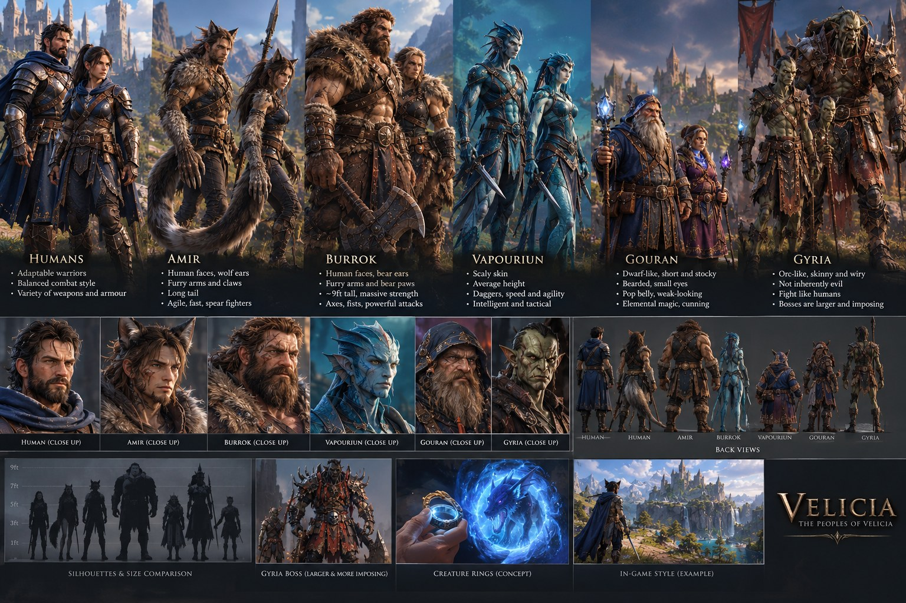

# Velicia — Character Design Specification

**Status:** authoritative. These rules apply to all concept art, 3D models,
character descriptions, rigs and animations for Velicia. If an older note,
prompt or asset conflicts with this document, this document wins.

**Canon:** the six peoples below are established canon. Do not rename them,
merge them or change their defining physical traits.

**Art direction:** high-fidelity, painterly-realistic 3D fantasy (see the
author's reference sheet below), scaled for an Android open-world RPG.

**Visual reference (authoritative):**

`docs/reference/peoples_of_velicia.jpg` shows the intended look of every
people: close-ups, back views, the size comparison, the Gyria boss, the
creature-ring concept and the in-game style target. New concept art and
models must match it. All
designs are original to Velicia and must not copy protected characters or
distinctive designs from existing franchises.

The current in-game models are **procedural placeholders** built in
`scripts/core/placeholder_body.gd` (`PlaceholderBody.preset()`), which encodes
the proportions below so silhouettes already read correctly in play.

---

## Silhouette summary

Each people must be recognisable from a distance by silhouette alone.

| People | Height | Build | Silhouette read | Signature weapons |
|---|---|---|---|---|
| Humans | ~1.78 m | Varied | Baseline | Varied |
| Amir | ~1.80 m | Lean, athletic | Slim upright figure, long trailing tail, spear line | Spear |
| Burrok | ~2.75 m (9 ft) | Massive, broad | Huge wedge, heavy shoulders, great axe or fists | Bare hands, large axes |
| Vapouriun | ~1.74 m | Light, quick, slender | Blue scaled figure, finned head crest and ears, twin daggers | Daggers |
| Gouran | ~1.30 m | Short, stocky, pot-bellied | Compact block with a round belly, long beard, hooded robes, crystal staff | Elemental magic |
| Gyria soldier | ~1.86 m | Skinny, wiry | Tall narrow figure, long limbs, angular head | Weapons like human warriors |
| Gyria boss | ≥ 1.25× soldier (prototype: ~2.7 m) | Imposing | Clearly larger Gyria with distinctive gear | Unique per boss |

---

## Humans
- A wide range of builds, skin tones and fighting styles.
- Human warriors, settlements, guilds, kingdoms and factions.
- The player character is an Emoria Guild warrior; in the current build they are
  human and customisable (skin tone, hair colour/style, cloak, build). No fixed
  protagonist name is set.

## Amir — human-faced wolf people
**Mandatory**
- **Clearly human faces**: human nose, mouth, jaw and facial proportions.
- **No wolf muzzle, no canine snout, no fully wolf-like head.** Ever.
- **Wolf ears** on top of the head (in addition to a human face).
- Hairy, furry arms ending in **clawed hands**, and long, bushy wolf-like tails.
- Lean, athletic, agile bodies; wild, layered hair.

**Combat:** spears; speed, evasion, reach and rapid, precise attacks.
**Clothing:** mobility first — light leather, wraps, fitted layers, tail openings.
**Animation:** the tail is a secondary-motion chain that reinforces speed and direction.

## Burrok — human-faced bear people
**Mandatory**
- **Clearly human faces**: human nose, mouth, jaw and facial proportions.
- **No bear muzzle, no fully bear-like head.** Ever.
- **Rounded bear ears**; thick beards are common.
- **Furry forearms ending in large bear-like paws/hands.**
- About **nine feet (≈2.75 m)** tall; heavily muscular and broad.
- Strength shown through body mass, hands, neck and shoulders — never by
  animalising the face.

**Combat:** bare hands or large axes; heavy attacks, grapples, guard breaks,
absorbing damage.
**Armour:** substantial and scaled to their size.

## Vapouriun — water-associated people *(visual identity: draft for approval)*
**Canon:** about average human size; fast, intelligent, skilled with daggers;
fighting style built on agility, quick attacks, evasion and tactics.

**Visual identity (per the reference sheet):**
- **Blue, scaly skin** with darker patterning, lighter on the face and chest.
- **Finned head crests and fin-like ears**; sharp, intelligent features.
- Slender, agile build; close-fitting leather straps and light armour.
- Twin daggers; light boots; no heavy armour.

## Gouran — dwarf-like elemental wizards
**Mandatory**
- Look like a distinctive fantasy **dwarf** people, **not goblins**.
- Short, stocky, solidly built: broad shoulders, thick limbs, compact proportions.
- Distinctive, unattractive, weathered faces: heavy brows, **small deep-set
  eyes**, broad noses, unusual features. **Long beards** are typical.
- A **pot belly** and a soft, weak-looking body — their power is magical.
- **Not** goblin-like: no large pointed ears, no spindly limbs, no impish face,
  no green skin, no hunched sneaky posture.
- An original people of Velicia — avoid miner/brewer/hammer clichés as their
  defining identity. Their identity is elemental scholarship, cunning and pride.

**Clothing:** hooded, rugged wizard robes, layered garments, belts, pouches,
practical tools, and staffs topped with glowing elemental crystals.
**Combat:** elemental magic, intelligence and cunning rather than strength.
Their small stature should contrast with their magical power and personality.

## Gyria — skinny orc-like warriors
**Standard soldiers — mandatory**
- **Skinny, wiry and lean** — never bulky or heavily muscular.
- **Green skin**, pointed ears, small tusks.
- Narrow shoulders, relatively long limbs, angular faces, battle-worn look.
- Practical, worn armour suited to warfare; not excessively elaborate.
- Weapons and tactics comparable to human warriors.

**Morality and culture**
- The Gyria are **not inherently evil**; appearance never decides morality.
- They are a civilisation with leaders, culture, loyalties, grievances and
  internal divisions. Some are cruel; others fight for survival, territory,
  belief or to protect their own. Allies, neutrals and enemies can all be Gyria.

**Bosses and leaders**
- **Visibly larger and taller** than standard soldiers (≥ 1.25× height) so
  players immediately recognise a more dangerous opponent.
- Keep Gyria features and ancestry, with an imposing presence, stronger
  proportions and more distinctive equipment.
- **Unique combat patterns, attacks and animations** — not just more health.
- Bulky proportions are **reserved for bosses**.

---

## Asset review checklist (every model)
- [ ] Amir: human face, no muzzle/snout; wolf ears; furry clawed arms; long tail; lean build.
- [ ] Burrok: human face, no muzzle; bear ears; furry arms and paws; ~9 ft; massive build.
- [ ] Vapouriun: average size; blue scaled skin; fins; daggers.
- [ ] Gouran: dwarf-like, stocky, pot belly, beard, weathered face; not goblin-like.
- [ ] Gyria soldier: skinny and wiry; not bulky.
- [ ] Gyria boss: clearly larger than soldiers; unique moveset.
- [ ] Silhouettes distinct at distance; design is original.
- [ ] Within the mobile budgets in [ASSET_REQUIREMENTS.md](ASSET_REQUIREMENTS.md).
